# Pràctica NFS: compartició d'una carpeta entre Ubuntu Server i Zorin OS

**Alumne:** Sergi Novell
**Data:** 5 de novembre de 2026

## Objectiu

Compartir la carpeta `/srv/nfs/compartit` d'un servidor Ubuntu Server amb un client Zorin OS mitjançant NFS, treballant per SSH, i deixar el muntatge permanent amb `/etc/fstab`.

| Màquina | Sistema | IP | Usuari de prova |
| --- | --- | --- | --- |
| Servidor | Ubuntu Server | 192.168.1.168 | usuari_smx (UID/GID 1100) |
| Client | Zorin OS | 192.168.1.169 | usuari_smx (UID/GID 1100) |

Les dues màquines estan amb **adaptador pont**, així es veuen entre elles i el PC hi entra per SSH.

> **Nota sobre la IP:** la pràctica es va fer en dues sessions. A la primera, el router va donar al servidor la IP `192.168.1.153` (captures 05 a 13). A la segona, en tornar a engegar les màquines, el DHCP li va donar la `192.168.1.168`, que és la que surt a la resta de captures. Amb adaptador pont la IP la reparteix el router i pot canviar.

---

## Part 1: Preparació i SSH

### Pas 1: IP de cada màquina

```bash
ip a
```

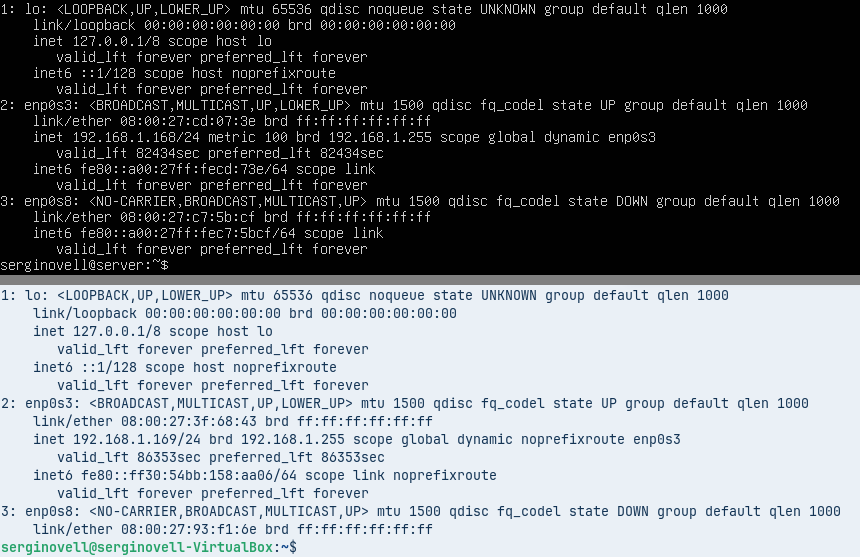

Consultem la IP de cada màquina virtual (a dalt el servidor, a baix el client). Al servidor, `enp0s3` té la `192.168.1.168` i, al client, la `192.168.1.169`. Totes dues són de la xarxa de casa perquè l'adaptador és pont.

### Pas 2: Instal·lar SSH

```bash
sudo apt update && sudo apt install openssh-server -y
```

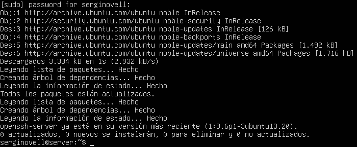

Instal·lem SSH per treballar des del PC copiant i enganxant les comandes. Surt que `openssh-server` ja està a la versió més recent i que tots els paquets estan actualitzats.

### Pas 3: Connexió per SSH

```bash
ssh serginovell@192.168.1.168
```

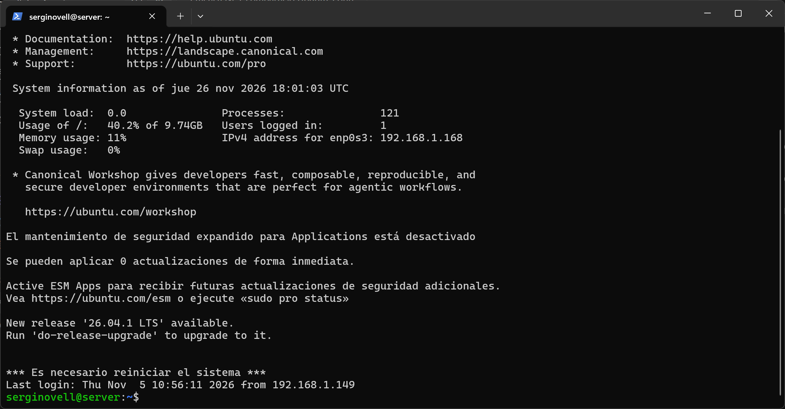

Ens connectem al servidor des del PC. La primera vegada demana confirmar la clau del servidor (`yes`) i després la contrasenya. El prompt `serginovell@server` mostra en quina màquina treballem.

### Pas 4: Comprovar la comunicació

```bash
ping -c 3 192.168.1.168
```

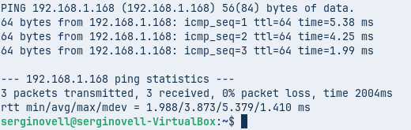

Comprovem que el client arriba al servidor abans de configurar res: 3 paquets enviats, 3 rebuts i `0% packet loss`.

---

## Part 2: Servidor (Ubuntu Server)

### Pas 5: Instal·lar el servei NFS

```bash
sudo apt update && sudo apt install nfs-kernel-server -y
```

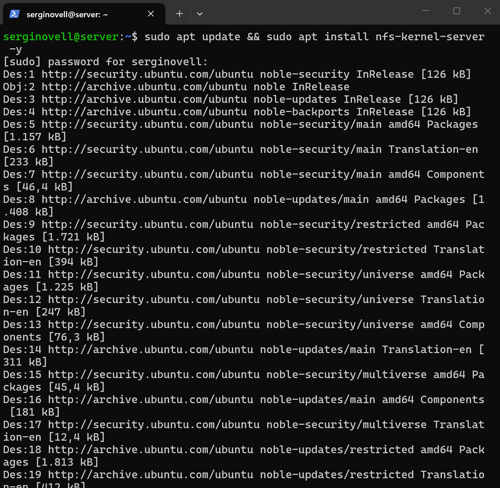

Instal·lem el paquet que converteix la màquina en servidor NFS.

### Pas 6: Crear el grup i l'usuari amb UID/GID fixos

```bash
sudo groupadd -g 1100 grup_smx
sudo useradd -u 1100 -m -g grup_smx usuari_smx
id usuari_smx
```

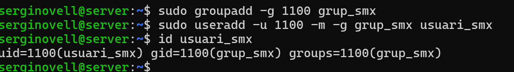

Creem l'usuari amb UID i GID 1100. NFS identifica els usuaris pel número, no pel nom.

### Pas 7: Crear la carpeta i assignar permisos

```bash
sudo mkdir -p /srv/nfs/compartit
sudo chown usuari_smx:grup_smx /srv/nfs/compartit
sudo chmod 750 /srv/nfs/compartit
ls -ld /srv/nfs/compartit
```

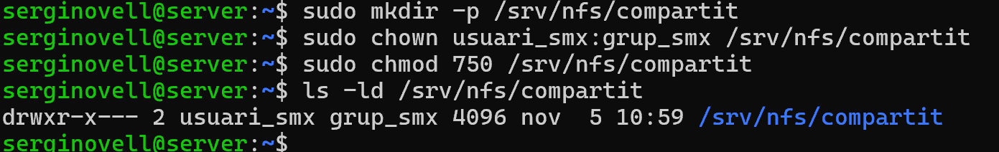

La carpeta és de `usuari_smx:grup_smx` amb permisos `drwxr-x---` (750): tot per al propietari, lectura i execució per al grup i res per als altres.

### Pas 8: Definir l'exportació a /etc/exports

```bash
sudo nano /etc/exports
```

Línia que s'ha d'afegir al final:

```text
/srv/nfs/compartit *(rw,sync,no_subtree_check)
```

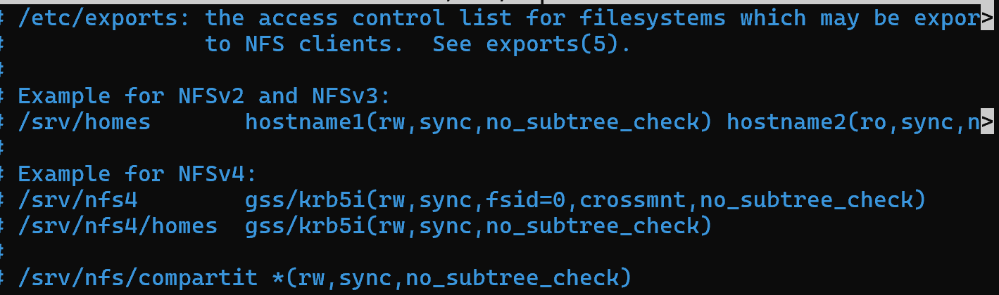

Indiquem què es comparteix i amb quines opcions: `rw` lectura i escriptura, `sync` escriu al disc abans de respondre, `no_subtree_check` evita comprovacions innecessàries, i `*` permet qualsevol client.

> **Atenció:** en aquesta captura la línia comença per `#`, per tant està **comentada** i el servidor no exporta res. És l'origen de l'error dels passos 12 i 13 (vegeu "Problemes trobats").

### Pas 9: Aplicar els canvis i comprovar el servei

```bash
sudo exportfs -a
sudo systemctl restart nfs-kernel-server
sudo exportfs -v
systemctl status nfs-kernel-server
```

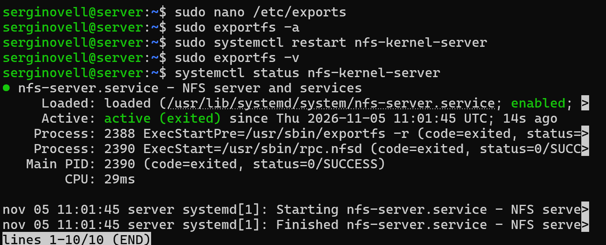

Apliquem la configuració i reiniciem el servei, que queda `active (exited)`. Això és normal en aquest servei. Cal notar que `exportfs -v` no mostra cap recurs, senyal que `/etc/exports` no tenia cap exportació activa.

---

## Part 3: Client (Zorin OS)

### Pas 10: Instal·lar el client NFS

```bash
sudo apt update && sudo apt install nfs-common -y
```

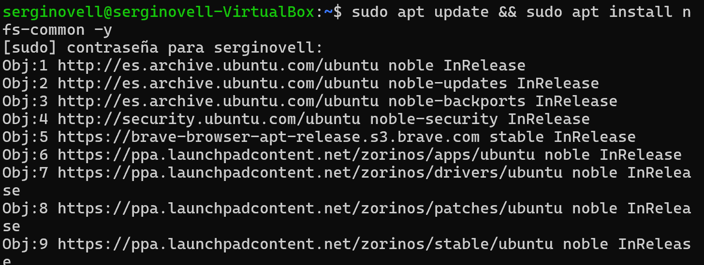

Instal·lem les eines per muntar recursos NFS.

### Pas 11: Crear el mateix grup i usuari

```bash
sudo groupadd -g 1100 grup_smx
sudo useradd -u 1100 -m -g grup_smx usuari_smx -s /bin/bash
sudo passwd usuari_smx
id usuari_smx
```

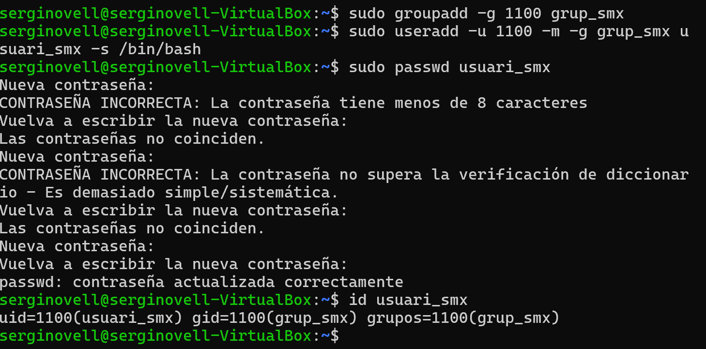

L'usuari té el mateix UID i GID (1100) que al servidor, perquè els permisos coincideixin. El `passwd` va rebutjar les primeres contrasenyes per ser massa curtes o simples, fins que n'he posat una vàlida.

### Pas 12: Comprovar que el servidor ofereix el recurs

```bash
showmount -e 192.168.1.153
```

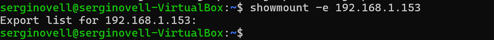

La llista d'exportacions surt **buida**, perquè el servidor no exporta res (la línia d'`/etc/exports` estava comentada).

### Pas 13: Muntar la carpeta (primer intent, amb error)

```bash
sudo mkdir -p /mnt/compartit
sudo mount -t nfs 192.168.1.153:/srv/nfs/compartit /mnt/compartit
```

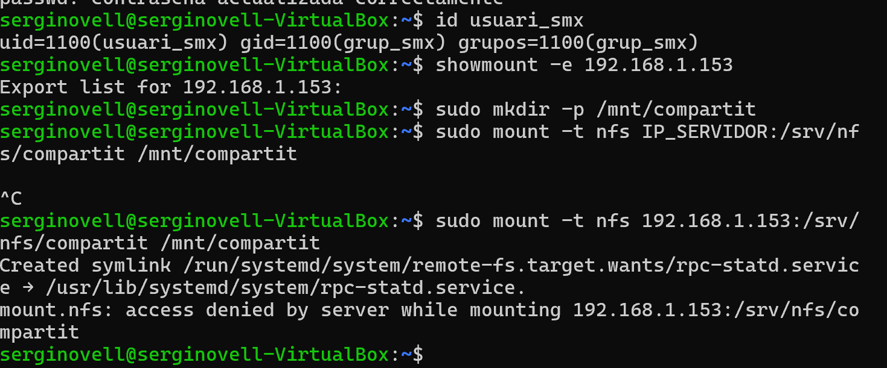

El primer intent va fallar perquè vaig deixar `IP_SERVIDOR` sense substituir per la IP real. Amb la IP correcta, el servidor respon `access denied by server`, per la mateixa raó que al pas 12.

---

## Problemes trobats i solució

**Error:** `mount.nfs: access denied by server while mounting`.

**Causa:** a `/etc/exports` la línia `/srv/nfs/compartit *(rw,sync,no_subtree_check)` tenia un `#` al davant i estava comentada. Per això `exportfs -v` no mostrava res i `showmount -e` retornava la llista buida.

**Solució:** esborrar el `#` i tornar a aplicar l'exportació al servidor:

```bash
sudo nano /etc/exports
sudo exportfs -ra
sudo exportfs -v
```

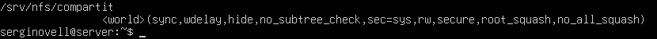

Ara `exportfs -v` mostra `/srv/nfs/compartit <world>(...)`. Entre les opcions també surt `root_squash`, que s'aplica per defecte.

Després, al client (el servidor ja tenia la IP nova, `192.168.1.168`):

```bash
showmount -e 192.168.1.168
sudo mount -t nfs 192.168.1.168:/srv/nfs/compartit /mnt/compartit
df -h | grep compartit
```

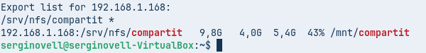

Ara el recurs es veu a `showmount` (`/srv/nfs/compartit *`) i queda muntat a `/mnt/compartit`.

**Altres incidències:**
- A la segona sessió el servidor va canviar d'IP (`192.168.1.153` → `192.168.1.168`) perquè amb adaptador pont la dona el DHCP del router. Ho vaig veure amb `ip a` i vaig fer servir la IP nova al `mount` i a `fstab`.
- No recordava la contrasenya d'`usuari_smx` i el `su -` donava `Fallo de autenticación`. La vaig tornar a posar amb `sudo passwd usuari_smx`.

---

## Part 4: Proves

### Pas 14: Crear un fitxer com a usuari_smx

```bash
su - usuari_smx
cd /mnt/compartit
touch fitxer_prova.txt
ls -l fitxer_prova.txt
```

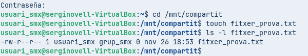

Comprovem que l'usuari pot escriure a la carpeta compartida. El fitxer queda amb propietari `usuari_smx` i grup `grup_smx`.

### Pas 15: Verificar el fitxer al servidor

```bash
sudo ls -l /srv/nfs/compartit
```

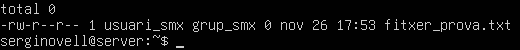

El fitxer creat des del client es guarda realment al servidor, amb propietari `usuari_smx`. Cal `sudo` perquè `serginovell` no és del grup `grup_smx` i la carpeta té permisos 750.

### Pas 16 (opcional): Accés denegat amb un altre usuari

```bash
exit
ls /mnt/compartit
```

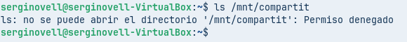

En sortir d'`usuari_smx` tornem a ser `serginovell` (UID 1000), i `ls` diu `Permiso denegado`. Un usuari amb un altre UID no pot accedir, per culpa del permís 750. Això confirma que NFS es basa en UID i GID.

---

## Part 5: Muntatge permanent (client)

### Pas 17: Desmuntar la carpeta

```bash
cd ~
sudo umount /mnt/compartit
df -h | grep compartit
```

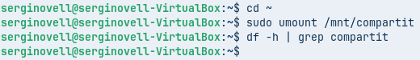

El muntatge anterior era temporal. El `df` ja no mostra el recurs.

### Pas 18: Afegir l'entrada a /etc/fstab

```bash
sudo nano /etc/fstab
```

Línia afegida al final:

```text
192.168.1.168:/srv/nfs/compartit /mnt/compartit nfs defaults 0 0
```

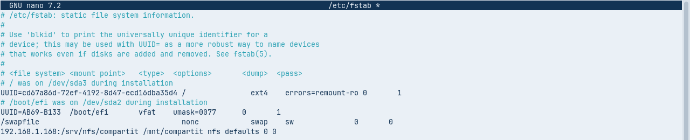

La línia indica el recurs remot, el punt de muntatge, el tipus (`nfs`), les opcions (`defaults`) i dos zeros: sense comprovació ni ordre de muntatge específic.

### Pas 19: Muntar tot el que hi ha a fstab

```bash
sudo mount -a
mount | grep compartit
```

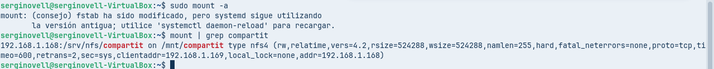

`mount -a` munta totes les entrades de fstab sense reiniciar. Surt un avís que diu que `systemd` encara fa servir la versió antiga de `fstab` (es podria fer `sudo systemctl daemon-reload`), però el recurs es munta igualment, com es veu amb `mount` (tipus `nfs4`, `rw`).

### Pas 20: Reiniciar i comprovar el muntatge automàtic

```bash
sudo reboot
df -h | grep compartit
```

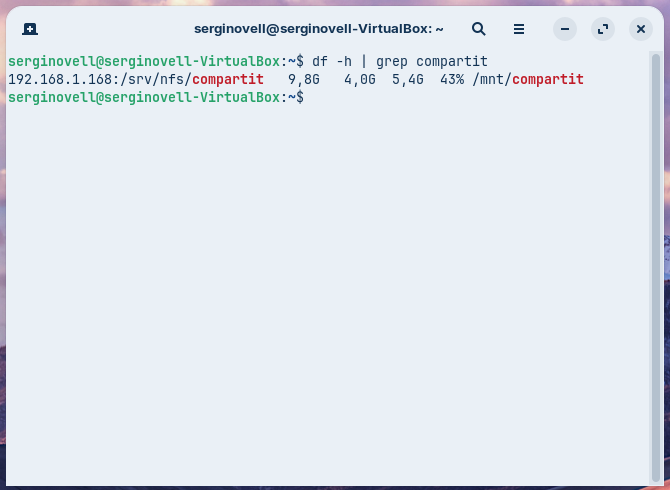

Després de reiniciar i tornar a entrar amb `serginovell`, la carpeta continua muntada sense haver fet cap `mount`: el muntatge és permanent.

### Pas 21 (opcional): Accés amb sessió gràfica

Inici de sessió a Zorin OS amb `usuari_smx` i accés a `/mnt/compartit`.

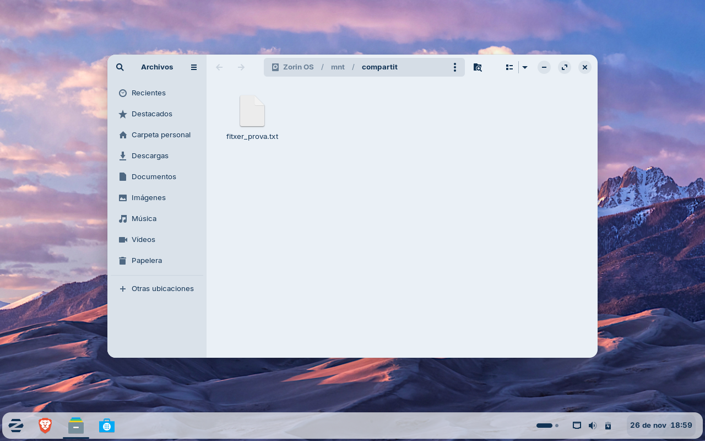

L'usuari accedeix a la carpeta compartida de manera automàtica i hi veu el `fitxer_prova.txt` que havia creat des del terminal.

---

## Conclusions

S'ha compartit una carpeta del servidor Ubuntu Server amb un client Zorin OS i `usuari_smx` hi pot crear fitxers, perquè té el mateix UID i GID (1100) a les dues màquines.

L'exportació es defineix a `/etc/exports` i el muntatge permanent al client, a `/etc/fstab`. NFS no valida usuaris: es fia dels permisos del servidor, així que cal mantenir els UID i GID coherents. En entorns grans, amb un sistema centralitzat com LDAP.
