# Activitat: Gestió d'usuaris i grups a Ubuntu Server

**Mòdul:** Sistemes Operatius
**Servidor:** Ubuntu Server 24.04 (noble) — host `nomequip`
**Usuari administrador:** `usuari`
**Alumne:** _(Sergi Novell)_ — **Número de llista:** 17

---

## Índex

1. [Tasca 1. Creació de la jerarquia de grups](#tasca-1-creació-de-la-jerarquia-de-grups)
2. [Tasca 2. Gestió dels perfils d'usuari](#tasca-2-gestió-dels-perfils-dusuari)
3. [Tasca 3. Creació i configuració d'usuaris](#tasca-3-creació-i-configuració-dusuaris)
4. [Tasca 4. Inspecció del sistema i fitxers de configuració](#tasca-4-inspecció-del-sistema-i-fitxers-de-configuració)
5. [Tasca 5. Personalització de l'entorn d'usuari](#tasca-6-personalització-de-lentorn-dusuari)

---

## Tasca 1. Creació de la jerarquia de grups

### Objectiu
Crear tres grups nous al sistema: `devs` (desenvolupament), `sysadmin` (sistemes) i `auditor` (auditor extern), i comprovar-ne el GID.

### Comandes utilitzades

```bash
sudo groupadd devs
sudo groupadd sysadmin
sudo groupadd auditor
tail -n 5 /etc/group
```

### Explicació
- `groupadd <nom>` crea un grup nou i li assigna automàticament el primer GID lliure a partir de 1000 (els grups de sistema tenen GID més baix).
- `tail -n 5 /etc/group` mostra les últimes 5 línies del fitxer `/etc/group`, on el sistema guarda la llista de grups. Cada línia té el format `nom:x:GID:membres`.

### Captura del resultat

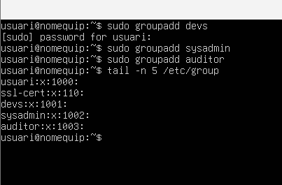

### Conclusió
Els tres grups s'han creat correctament amb els GID següents:

| Grup | GID |
|------|------|
| `devs` | **1001** |
| `sysadmin` | **1002** |
| `auditor` | **1003** |

---

## Tasca 2. Gestió dels perfils d'usuari

### Objectiu
Fer que tots els usuaris nous tinguin automàticament un fitxer de benvinguda, una carpeta `Documents` i l'alias `ll`. Per fer-ho es modifica el directori plantilla `/etc/skel`.

### 2.1 Fitxer de benvinguda

```bash
sudo nano /etc/skel/BIENVENIDA.txt
cat /etc/skel/BIENVENIDA.txt
```

**Explicació:** Es crea el fitxer `BIENVENIDA.txt` dins de `/etc/skel` amb les normes d'ús del servidor. Tot el que hi ha dins d'aquest directori es copia al `/home` de cada usuari nou en el moment de crear-lo.


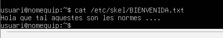

### 2.2 Carpeta Documents i alias `ll`

```bash
sudo mkdir /etc/skel/Documents
echo "alias ll='ls -la --color=auto'" | sudo tee -a /etc/skel/.bashrc
```

**Explicació:**
- `mkdir /etc/skel/Documents` crea la carpeta que tindran per defecte tots els usuaris nous.
- `echo ... | sudo tee -a` afegeix (`-a` = *append*) la línia de l'alias al final del `.bashrc` de la plantilla. Es fa amb `tee` perquè la redirecció `>>` no hereta els permisos de `sudo`.
- L'alias fa que en escriure `ll` s'executi `ls -la --color=auto`.

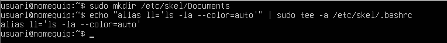

### 2.3 Shell per defecte a `/etc/adduser.conf`

```bash
grep DSHELL /etc/adduser.conf
```

**Explicació:** El fitxer `/etc/adduser.conf` conté els valors per defecte de la comanda `adduser`. La variable `DSHELL` defineix la shell dels usuaris nous. A la sortida es veu que el valor per defecte és `DSHELL=/bin/bash`.

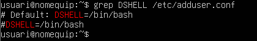

**Conclusió:** La shell per defecte per als usuaris nous és `/bin/bash`.

### 2.4 Comprovació amb un usuari de prova (`prova17`)

```bash
sudo adduser prova17
su - prova17
ls -la
ll
```

**Explicació:**
- `adduser prova17` crea l'usuari, el seu grup, el directori `/home/prova17` i hi copia el contingut de `/etc/skel` (es veu el missatge *Copying files from `/etc/skel`*).
- `su - prova17` inicia sessió com aquest usuari amb el seu entorn complet.
- `ls -la` i `ll` mostren el contingut del directori personal.

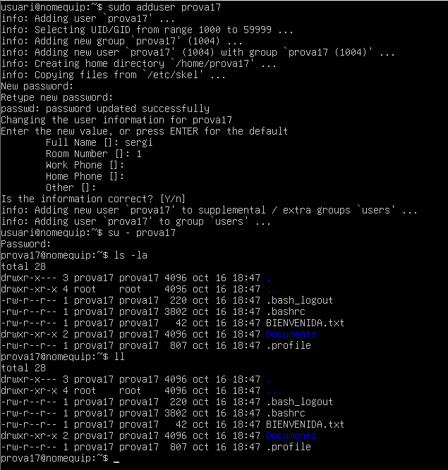

**Conclusió:** El directori personal de `prova17` conté `BIENVENIDA.txt`, la carpeta `Documents` i el `.bashrc` amb l'alias, i l'ordre `ll` funciona (mostra el llistat llarg amb colors).

### 2.5 Eliminació de l'usuari de prova

Un cop fetes les comprovacions, es torna a la sessió de l'administrador (`exit`) i s'elimina l'usuari de prova:

```bash
exit
sudo deluser --remove-home prova17
```

**Explicació:** La comanda `deluser -r` dóna error perquè l'opció `-r` és ambigua (`--remove-home` o `--remove-all-files`), tal com es veu a la captura. Cal escriure l'opció completa: `--remove-home` elimina l'usuari i el seu directori personal.

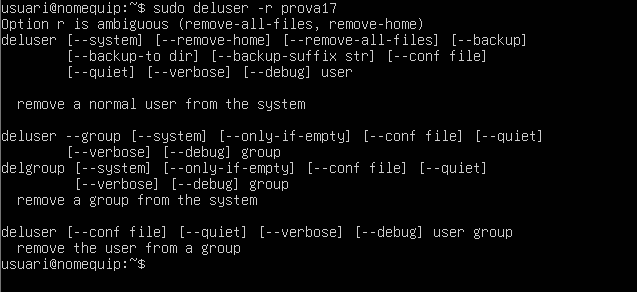


---

## Tasca 3. Creació i configuració d'usuaris

### Objectiu
Crear els usuaris indicats a l'enunciat amb el seu grup principal, grups secundaris, directori personal i shell.

| Usuari | Nom real | Grup principal | Grups secundaris | Home | Shell |
|--------|----------|----------------|------------------|------|-------|
| `pau_dev` | Pau Garcia | `devs` | — | `/home/pau_dev` | `/bin/bash` |
| `laura_dev` | Laura Martí | `devs` | — | `/home/laura_dev` | `/bin/bash` |
| `marc_sys` | Marc Soler | `sysadmin` | `devs` | `/home/marc_sys` | `/bin/bash` |
| `auditor` | Usuari Auditor | `auditor` | — | `/home/auditor` | `/bin/bash` |

### 3.1 Usuaris `pau_dev` i `laura_dev` amb `adduser`

```bash
sudo adduser --ingroup devs --gecos "Pau Garcia" pau_dev
sudo adduser --ingroup devs --gecos "Laura Martí" laura_dev
```

**Explicació:**
- `adduser` és l'script d'alt nivell de Debian/Ubuntu: crea l'usuari, el home (copiant `/etc/skel`) i demana la contrasenya de manera interactiva.
- `--ingroup devs` fixa `devs` com a **grup principal** (si no es posa, crearia un grup amb el nom de l'usuari).
- `--gecos` desa el nom real a la base de dades d'usuaris (camp *comentari* de `/etc/passwd`).

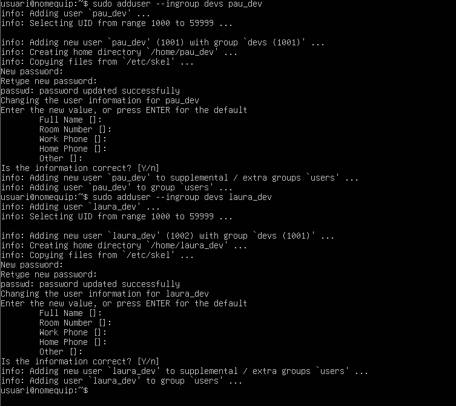

### 3.2 Usuaris `marc_sys` i `auditor` amb `useradd`

```bash
sudo useradd -m -d /home/marc_sys -s /bin/bash -g sysadmin -G devs -c "Marc Soler" marc_sys
sudo useradd -m -d /home/auditor -s /bin/bash -g auditor -c "Usuari Auditor" auditor
```

**Explicació dels paràmetres:**

| Paràmetre | Significat |
|-----------|------------|
| `-m` | Crea el directori personal (copiant `/etc/skel`) |
| `-d` | Ruta del directori personal |
| `-s` | Shell de login |
| `-g` | Grup **principal** |
| `-G` | Grups **secundaris** |
| `-c` | Comentari (nom real) |

> **Nota:** a la captura es veu que la primera execució de `useradd` per a `auditor` va fallar amb *Permission denied* perquè s'havia oblidat `sudo`; es va repetir amb `sudo` i es va crear correctament.

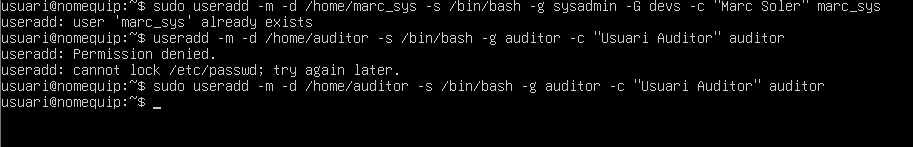

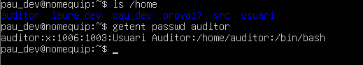

### 3.3 Contrasenya inicial `Canviam2026!`

```bash
echo 'pau_dev:Canviam2026!' | sudo chpasswd
echo 'laura_dev:Canviam2026!' | sudo chpasswd
echo 'marc_sys:Canviam2026!' | sudo chpasswd
echo 'auditor:Canviam2026!' | sudo chpasswd
```

**Explicació:** `chpasswd` llegeix línies amb format `usuari:contrasenya` i assigna la contrasenya sense interacció. Així es pot assignar la mateixa contrasenya inicial a tots els usuaris (inclosos `marc_sys` i `auditor`, creats amb `useradd`, que no tenen contrasenya per defecte).

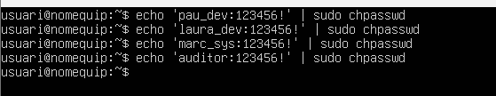

### 3.4 Forçar el canvi de contrasenya a `pau_dev`

```bash
sudo chage -d 0 pau_dev
sudo chage -l pau_dev
```

**Explicació:** `chage -d 0` posa la data de l'últim canvi de contrasenya a 0 (1 de gener de 1970), de manera que el sistema considera que la contrasenya ha caducat i obliga a canviar-la al pròxim inici de sessió. `chage -l` mostra l'estat de l'envelliment de la contrasenya.


### 3.5 Verificació: inici de sessió com a `pau_dev`

```bash
su - pau_dev
```

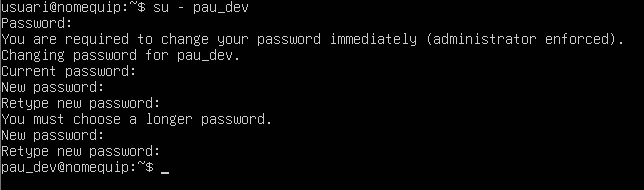

**Conclusió:** En iniciar sessió com a `pau_dev`, el sistema mostra el missatge *"You are required to change your password immediately (administrator enforced)"* i demana la contrasenya actual i una de nova. També es veu que `passwd` rebutja contrasenyes massa curtes (*You must choose a longer password*). Queda comprovat que `chage -d 0` funciona.

---

## Tasca 4. Inspecció del sistema i fitxers de configuració


### 4.1 Directori plantilla per als usuaris nous

```bash
grep SKEL /etc/adduser.conf
```

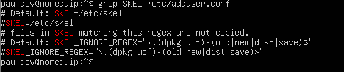

**Resposta:** El directori plantilla és **`/etc/skel`**. La seva configuració està definida a la variable `SKEL=/etc/skel` del fitxer **`/etc/adduser.conf`** (per a `adduser`; `useradd -m` utilitza `/etc/skel` per defecte, definit a `/etc/default/useradd` / `/etc/login.defs`). El filtre `SKEL_IGNORE_REGEX` evita copiar fitxers de còpia de seguretat de paquets (`.dpkg-old`, `.ucf-dist`, etc.).

---


## Tasca 5. Personalització de l'entorn d'usuari

### 5.1 Instal·lació de `fish`

```bash
sudo apt update
sudo apt install fish -y
which fish
```

**Explicació:** `apt update` refresca la llista de paquets dels repositoris i `apt install fish` instal·la la shell (juntament amb les dependències `fish-common`, `bzip2`, etc.). `which fish` mostra la ruta de l'executable: `/usr/bin/fish`.

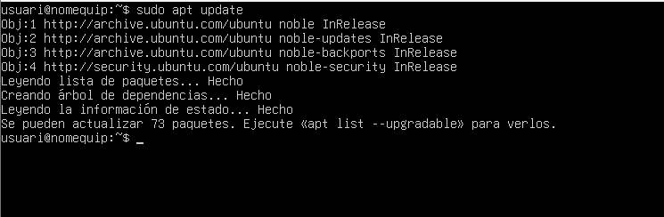

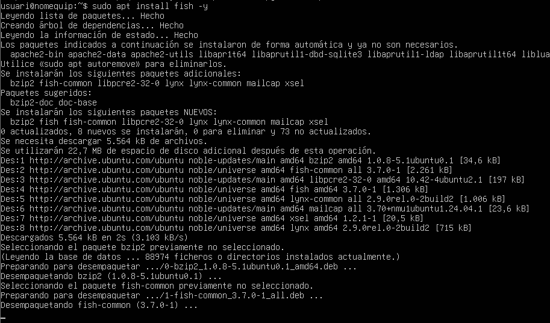

### 5.2 Canvi de shell de `laura_dev`

```bash
sudo usermod -s /usr/bin/fish laura_dev
grep laura_dev /etc/passwd
```

**Explicació:** `usermod -s` canvia la shell de login de l'usuari. L'últim camp de la línia de `/etc/passwd` és la shell.

### 5.3 Verificació

```bash
su - laura_dev
echo $SHELL
fish --version
```

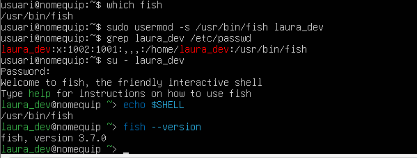

**Conclusió:** A `/etc/passwd` la línia de `laura_dev` acaba amb `/usr/bin/fish`. En iniciar sessió amb `su - laura_dev` apareix el missatge *"Welcome to fish, the friendly interactive shell"*, `echo $SHELL` retorna `/usr/bin/fish` i la versió instal·lada és la 3.7.0. El canvi de shell s'ha aplicat correctament.

---

## Conclusió general

S'ha creat una jerarquia de grups (`devs`, `sysadmin`, `auditor`), s'ha personalitzat `/etc/skel` perquè els usuaris nous rebin automàticament un fitxer de benvinguda, una carpeta `Documents` i l'alias `ll`, i s'han creat usuaris tant amb `adduser` com amb `useradd`. També s'ha practicat l'obligació de canviar la contrasenya (`chage`), l'estudi dels fitxers `/etc/passwd`, `/etc/shadow` i `/etc/adduser.conf`, el bloqueig/desbloqueig i eliminació de comptes, i el canvi de shell d'un usuari a `fish`.

---
